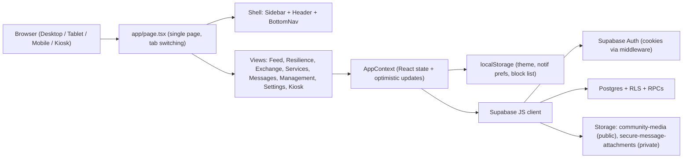

# TESDH Community Hub — Test Scenarios & QA Checklist

> **Scope:** The whole application. That means the Next.js 16 app shell, the 8 feature modules, `AppContext` state, Supabase Auth/DB/RLS/RPCs, Storage buckets, theming, i18n, responsive layout and accessibility.
> **Based on:** A code review of `src/`, `supabase/migrations/`, `tests/`, `DESIGN.md` and `INTERACTIONS.md` (17 Oct 2026).
> **How to use:** Work through the sections in order. Tick `[ ]` → `[x]` when a scenario passes. Write **FAIL + note** in the *Result* column when it doesn't. Run Section 2 (**Known Risks**) first, because those are the scenarios most likely to fail.

---

## 0. Status Legend & Severity

| Mark | Meaning |
| :--- | :--- |
| `[ ]` | Not yet tested |
| `[x]` | Passed |
| **FAIL** | Failed. Write a short note and a screenshot path |
| **P0** | Security / data-loss / privacy (PDPA) issue. Blocks release |
| **P1** | Core feature broken |
| **P2** | Degraded UX, visual or edge-case issue |

---

## 1. Architecture Overview (What You Are Testing)



### 1.1 Key architectural facts that shape testing

| Area | Behaviour in code | Testing implication |
| :--- | :--- | :--- |
| Routing | One route `/`. Views switch via `activeTab` in context. `kiosk` renders full-screen | No deep links. A browser refresh always returns to the default tab |
| Data source | State is seeded from `mockData.ts`, then overwritten by `refreshSupabaseData()` **only if** the tables return rows | Test with **(a)** no Supabase, **(b)** schema missing, **(c)** schema + seed |
| Writes | Optimistic local update first. Many Supabase writes are **fire-and-forget** (no `await`, no error check) | Always **refresh after every create/update** to confirm the change persisted |
| Client-only actions | Exchange reserve/complete/delete, service delete, messaging, message requests, notifications, moderation reports, audit log, upvotes, incident reject | Expect these to **vanish on refresh** and **not be visible to other users**. Verify and log each one |
| Identity | Logged-in user is built from `user_metadata`. `verificationStatus` is always set to `unverified` | Test real accounts in every verification state |
| Demo switcher | The Header profile switcher (`switchProfile`) lets anyone act as Nurul / Vikram / Azman / Rosli | Use it for UI role tests. Must be removed or gated before production |
| Roles | `resident`, `moderator`, `management`, `security` | Every permission scenario must be run against all 4 roles |
| Verification | `unverified` → `pending` → `verified` / `rejected` | Posting, listing and messaging are gated on `verified` in RLS |
| Storage | 10 MB, JPEG/PNG/WebP. If an upload fails, the code silently falls back to a base64 data URL | Test with the bucket present **and** missing |
| Boundary | `validateElminaCoordinates` (ray-casting polygon) runs client-side only | Out-of-boundary inserts through the API are not blocked by the DB |

### 1.2 Test accounts (demo profiles in `mockData.ts`)

| ID | Name | Role | Precinct | Verification |
| :--- | :--- | :--- | :--- | :--- |
| `user-nurul` | Nurul Huda binti Ahmad | resident | Elmina Green 3 | verified |
| `user-vikram` | Vikram Naidu a/l Mohan | resident | Denai Alam | **pending** |
| `user-azman` | Capt. (R) Azman Salleh | management | Elmina Central Park Hub | verified |
| `user-rosli` | Sergeant Rosli & Security Team | security | Elmina West Guardhouse | verified |
| *(create)* | Real Supabase account A | resident | any | unverified → verified |
| *(create)* | Real Supabase account B | resident | any | verified (for 2-user tests) |
| *(create)* | Real Supabase moderator | moderator | any | verified |

> [!IMPORTANT]
> The seed data has no **moderator** profile. Create one in Supabase (`update profiles set role='moderator' …`) so the moderator column of the permission matrix can be tested.

---

## 2. Known Risks Found During Code Review — TEST THESE FIRST

These are suspected defects found by reading the code. Each one needs to be confirmed or ruled out.

| ID | Sev | Suspected issue | Where | How to verify | Result |
| :--- | :--- | :--- | :--- | :--- | :--- |
| KR-01 | P0 | **Self-promotion at signup.** `handle_new_user()` copies `role` from `raw_user_meta_data`, so anyone can sign up as `management` | `20261016140000_tesdh_core_schema.sql` L173-195 | See **SEC-01** | [ ] |
| KR-02 | P0 | **PDPA leak.** `profiles` SELECT policy is `USING (true)`, and the client loads `select('*')` (unit number + phone of every resident) into memory | core schema L230; `AppContext.tsx` L408 | See **SEC-02**. Also check DevTools → Network → `profiles` response | [ ] |
| KR-03 | P0 | **Incident self-verification.** A reporter can `UPDATE` any column of their own report (e.g. `is_verified=true`, `status='resolved'`). Moderator/security can also set `is_verified` directly, bypassing the management-only RPC | `…170000…` L46-56 | See **SEC-03** | [ ] |
| KR-04 | P0 | **Notification spoofing.** `notifications` INSERT is `WITH CHECK (true)`, so any user can send a fake "official" alert to anyone | `…150000…` L99-102 | See **SEC-04** | [ ] |
| KR-05 | P0 | **Sender can accept own message request.** UPDATE policy allows `sender_id = auth.uid()` | `…150000…` L122-126 | See **SEC-05** | [ ] |
| KR-06 | P1/P0 | **Private attachments.** The recipient **cannot** view photos sent to them (SELECT allows only the owner or management). Management can read every private attachment | `…170000…` L178-186 | See **MSG-15 / SEC-06** | [ ] |
| KR-07 | P0 | **Unit enumeration.** `search_property_for_messaging` returns real `unit_number`. Searching a precinct name lists up to 8 units. The client allows 2 characters, the server 3 | `…150000…` L207-239; `AppContext` L1519 | See **MSG-04 / SEC-07** | [ ] |
| KR-08 | P1 | Logged-in real users always show as `unverified` and take their role from metadata, not from `profiles` | `AppContext` L631-676 | See **AUTH-08** | [ ] |
| KR-09 | P0 (prod) | Demo profile switcher lets any visitor become management in the UI | `Header.tsx` L214, `ManagementView.tsx` L108 | See **ROLE-10** | [ ] |
| KR-10 | P1 | Reserve, complete and delete actions (Exchange), delete (Services), messages, requests, notifications, moderation reports, audit logs, upvotes and incident rejection are **local state only** | `AppContext` L1036, 1210, 1414-1443, 1513, 1538-1816 | See **PER-01…PER-12** | [ ] |
| KR-11 | P1 | Fire-and-forget inserts (incident, exchange, service) show success even if RLS rejects them (e.g. unverified user) | `AppContext` L1119, 1393, 1493 | See **PER-13** | [ ] |
| KR-12 | P2 | Help-request fields (urgency, compensation, requested date, availability, extra photos) are not saved to `service_listings` | `AppContext` L1493-1503 | See **SRV-12** | [ ] |
| KR-13 | P1 | The block list lives only in `localStorage` and is **not checked** when someone sends a message request | `AppContext` L300-322, 1559-1565 | See **MSG-10** | [ ] |
| KR-14 | P2 | The 5-requests/day rate limit is client-only. A refresh or the API bypasses it | `AppContext` L1546-1557 | See **MSG-08** | [ ] |
| KR-15 | P2 | The duplicate-incident warning points to the *first unresolved incident*, not the matching one | `AppContext` L1080-1082 | See **RES-11** | [ ] |
| KR-16 | P2 | Upload failure silently stores a base64 data URL. The MIME check trusts the browser-reported type | `uploadMedia.ts` L82-88 | See **UPL-08/09** | [ ] |
| KR-17 | P2 | Elmina boundary is not enforced in the DB | `elminaBoundary.ts` (client only) | See **SEC-08** | [ ] |
| KR-18 | P2 | Announcement / security-alert posts are written to the DB as category `general` | `AppContext` L915 | See **FEED-05** | [ ] |
| KR-19 | P2 | `middleware.ts` convention is deprecated in Next 16 (build warning: use `proxy`) | `src/middleware.ts` | Check the `npm run build` output | [ ] |

---

## 3. Environment & Pre-flight

| ID | Scenario | Steps | Expected | Result |
| :--- | :--- | :--- | :--- | :--- |
| ENV-01 | Clean install | `npm install` | No errors. Lockfile unchanged | [ ] |
| ENV-02 | Type check | `npx tsc --noEmit` | 0 errors | [ ] |
| ENV-03 | Lint | `npm run lint` | 0 errors (log the warnings) | [ ] |
| ENV-04 | Unit tests | `npm test` | 53/53 pass, 11 suites | [ ] |
| ENV-05 | Production build | `npm run build && npm run start` | Builds. App serves on :3000 | [ ] |
| ENV-06 | No Supabase env | Remove `.env.local`, run dev | App loads with mock data. No crash. No infinite spinner | [ ] |
| ENV-07 | Supabase without schema | Point to an empty project | Schema-missing banner shows the migration hint. UI still usable | [ ] |
| ENV-08 | Supabase with schema + seed | Apply all 7 migrations in order, plus the seed | Seeded posts, incidents and listings replace the mock data | [ ] |
| ENV-09 | Migration re-run | Re-apply each migration | Idempotent (`IF NOT EXISTS` / `DROP POLICY IF EXISTS`). No errors | [ ] |
| ENV-10 | Storage buckets | Check Supabase → Storage | `community-media` (public) and `secure-message-attachments` (private), 10 MB, 3 MIME types | [ ] |
| ENV-11 | Secrets | `git ls-files \| findstr .env` | Only `.env.example` is tracked. No keys in source | [ ] |
| ENV-12 | Browsers | Chrome, Edge, Firefox, Safari iOS, Chrome Android | All primary flows work | [ ] |

---

## 4. Authentication & Profile

| ID | Scenario | Steps | Expected | Result |
| :--- | :--- | :--- | :--- | :--- |
| AUTH-01 | Sign up (happy path) | Open AuthModal → register with name, precinct, unit, phone | Account created. `profiles` row has `role=resident`, `verification_status=unverified` | [ ] |
| AUTH-02 | Sign up validation | Empty fields, bad email, short password, duplicate email | Inline errors. No account created | [ ] |
| AUTH-03 | Login / logout | Log in, then Sign Out | Session cookie set and cleared. Returns to Feed as the demo user | [ ] |
| AUTH-04 | Wrong password | Log in with a bad password | Clear error. No lockout loop | [ ] |
| AUTH-05 | Session persistence | Log in → refresh → close and reopen tab | Still logged in (cookies refreshed by middleware) | [ ] |
| AUTH-06 | Session expiry | Expire or revoke the token in Supabase | User is signed out gracefully. No broken state | [ ] |
| AUTH-07 | Two tabs | Log out in tab A | Tab B reflects logout on its next action | [ ] |
| AUTH-08 | Verified real user | Set a real account to `verified` in the DB → log in | UI should show **verified** and allow posting *(KR-08)* | [ ] |
| AUTH-09 | Edit profile | ProfileModal → change nickname, phone, avatar | Saved. Persists after refresh | [ ] |
| AUTH-10 | Nickname rules | Nickname of 1 char, 31+ chars, spaces only | <2 chars rejected. Truncated to 30 | [ ] |
| AUTH-11 | Read-only fields | Try to edit real name / unit / role in the UI | Not editable (see `profileEditing.test.ts`) | [ ] |
| AUTH-12 | Escalation via API | `update profiles set role='management'` as yourself | Rejected by RLS `WITH CHECK` | [ ] |

---

## 5. Roles & Permission Matrix

Run each row as all four roles. Use the demo switcher for UI tests, and real accounts for DB/RLS tests.

| ID | Action | Resident (verified) | Resident (pending/unverified) | Moderator | Security | Management | Result |
| :--- | :--- | :--- | :--- | :--- | :--- | :--- | :--- |
| ROLE-01 | Open Management Console | ✗ "Access Denied" notification | ✗ | ✗ | ✗ | ✓ | [ ] |
| ROLE-02 | Create feed post | ✓ | ✗ (RLS) | ✓ | ✓ | ✓ | [ ] |
| ROLE-03 | Post Announcement / Security Alert | ✗ | ✗ | ✗ | ✓ (alert) | ✓ | [ ] |
| ROLE-04 | Delete *another user's* post | ✗ | ✗ | per policy | ✗ | ✓ (with reason) | [ ] |
| ROLE-05 | Verify incident | ✗ | ✗ | ✗ | ✗ | ✓ | [ ] |
| ROLE-06 | Update incident status / dispatch | ✗ | ✗ | ? | ✓? | ✓ | [ ] |
| ROLE-07 | Archive resolved incident | ✗ | ✗ | ✗ | ✗ | ✓ | [ ] |
| ROLE-08 | Approve resident verification | ✗ | ✗ | ✗ | ✗ | ✓ | [ ] |
| ROLE-09 | Change a user's role | ✗ | ✗ | ✗ | ✗ | ✓ | [ ] |
| ROLE-10 | Demo switcher available | Should be hidden in production *(KR-09)* | | | | | [ ] |
| ROLE-11 | View audit logs | ✗ | ✗ | ✗ | ✓ (RLS) | ✓ | [ ] |
| ROLE-12 | Send property message request | ✓ | ✗ | ✗? | ✓ | ✓ | [ ] |

> Fill each `?` with the observed behaviour, then confirm it with the product owner.

---

## 6. App Shell, Navigation & Layout

| ID | Scenario | Steps | Expected | Result |
| :--- | :--- | :--- | :--- | :--- |
| NAV-01 | Desktop shell (≥1024 px) | Open each tab | Sidebar is fixed. Only the content region scrolls. No whole-page scrollbar | [ ] |
| NAV-02 | Pinned headers | Scroll Exchange / Services / Settings | Header, search, filters and the primary CTA stay visible | [ ] |
| NAV-03 | Tab switching | Feed → Map → Exchange → Services → Messages → Settings | No layout jump. Scroll position resets per view | [ ] |
| NAV-04 | Mobile (390×844) | Use BottomNav | Bottom nav never covers buttons or the last card (`pb-16`) | [ ] |
| NAV-05 | Tablet (768–1023 px) | Resize | Sidebars collapse sensibly. No horizontal overflow | [ ] |
| NAV-06 | Horizontal overflow | Every view at 320 px wide | No sideways scroll | [ ] |
| NAV-07 | Z-index order | Open a dropdown, then a modal, then trigger a toast | Order is: sticky header < nav < bottom nav < modal/drawer < toast | [ ] |
| NAV-08 | Modal anatomy | Open every create/detail modal | Pinned header and footer. Body scrolls inside. Max height 90vh | [ ] |
| NAV-09 | Background scroll lock | Open a modal, scroll with wheel/touch | Background does not move. Scroll restored on close | [ ] |
| NAV-10 | Esc / backdrop click | Press Esc and click the backdrop on each modal | Closes, unless the form is dirty (then confirm) | [ ] |
| NAV-11 | Mobile keyboard | Focus inputs in modals on iOS/Android | Field stays visible. Footer buttons stay reachable (`dvh`) | [ ] |
| NAV-12 | Browser refresh | Refresh on any tab | Returns to the default tab. No crash *(single-route design)* | [ ] |
| NAV-13 | Nav micro-animations | Hover/focus each nav icon | Animations match `INTERACTIONS.md` §3. Labels don't shift | [ ] |

---

## 7. Community Feed

| ID | Scenario | Steps | Expected | Result |
| :--- | :--- | :--- | :--- | :--- |
| FEED-01 | Load feed | Open Feed | Pinned posts first, then sorted by the selected option | [ ] |
| FEED-02 | Sort options | Latest / Relevant / Official | Order changes correctly | [ ] |
| FEED-03 | Category filters | Each category chip | Only matching posts shown. Empty state when none | [ ] |
| FEED-04 | Create discussion with photo | Verified resident posts with an image | Success animation (INTERACTIONS §2). Card inserted at top with pulse. **Persists after refresh** | [ ] |
| FEED-05 | Management announcement | As Azman, post an announcement | Pinned with an official badge. After refresh it keeps its category *(KR-18)* | [ ] |
| FEED-06 | Anonymous complaint | Toggle anonymous on a `complaint` | Neighbours see "Anonymous Neighbour". Management can still trace the author | [ ] |
| FEED-07 | Anonymous on non-complaint | Toggle anonymous on a discussion | Anonymous flag ignored (only complaints may be anonymous) | [ ] |
| FEED-08 | Unverified user posting | As Vikram (pending) | Blocked with a clear message. No phantom post | [ ] |
| FEED-09 | Validation | Empty title/content. Very long text. Emoji. BM characters | Required fields enforced. Long text wraps. Unicode renders | [ ] |
| FEED-10 | XSS | Content `` | Rendered as text. No script runs | [ ] |
| FEED-11 | Upvote | Toggle upvote twice | +1 then −1. Never negative *(local only — check after refresh)* | [ ] |
| FEED-12 | Reply | Add a reply | Thread expands with animation. Count increments. Persists | [ ] |
| FEED-13 | Official reply badge | Management/security replies | "Official Response" badge shown | [ ] |
| FEED-14 | Delete own post | As the author | Removed from feed. Replies cleaned up. Soft-deleted in DB (`deleted_at`) | [ ] |
| FEED-15 | Moderate delete | Management deletes another user's post with a reason | Removed. Audit log `MODERATE_DELETE_POST`. Author cannot restore | [ ] |
| FEED-16 | No edit | Look for an edit option on posts/comments | None (edit permissions removed by migration `…180000`) | [ ] |
| FEED-17 | Report content | Report a post (spam/harassment/…) | Appears in Management → Moderation queue | [ ] |
| FEED-18 | Empty / offline | No posts. Network off | Friendly empty state. Error banner with retry | [ ] |

---

## 8. Resilience Map & Incident Reporting

| ID | Scenario | Steps | Expected | Result |
| :--- | :--- | :--- | :--- | :--- |
| RES-01 | Map load | Open Resilience | Leaflet map centred on Elmina. Markers for active incidents | [ ] |
| RES-02 | Zone presets | Each zone (Central Park, Valley, Green, Ilham, Denai Alam, Lakeside) | Map pans and zooms correctly | [ ] |
| RES-03 | Map / List toggle | Switch views | List shows the same incidents. Filters are kept | [ ] |
| RES-04 | No location selected | Start a report and try to confirm without a pin | Confirmation blocked (Rule 1) | [ ] |
| RES-05 | Pin outside Elmina | Drop a pin at KLCC or PJ | Clear boundary error. Cannot proceed (Rule 2) | [ ] |
| RES-06 | Pin on boundary edge | Pin just inside and just outside a polygon edge | Inside accepted. Outside rejected | [ ] |
| RES-07 | Move pin | Drag the pin to a new spot | Nearest landmark updates (Rules 3–4) | [ ] |
| RES-08 | Full report | Type, severity, title, description, photo, submit | Marker appears. Status `reported`, unverified. **Persists after refresh** | [ ] |
| RES-09 | Anonymous report | Toggle anonymous | Public name hidden. Management sees the reporter (Rule 7) | [ ] |
| RES-10 | Each incident type | flood, blocked_drain, fallen_tree, pothole, street_light, water_disruption, other | Correct icon, colour and label | [ ] |
| RES-11 | Duplicate warning | Report the same type within ~300 m of an open incident | Warning shown and links to the **correct** existing incident *(KR-15)* | [ ] |
| RES-12 | Resolved not duplicate | Same spot as a resolved incident | No duplicate warning | [ ] |
| RES-13 | Severity colours | low / medium / high / critical | Matches `DESIGN.md` | [ ] |
| RES-14 | Emergency contacts | Open the contacts panel | MBSA, Police, Bomba and Sime Darby ops numbers. `tel:` links work on mobile | [ ] |
| RES-15 | Verified alert broadcast | Management verifies → check another user | Critical notification to "all". Verified badge on the marker | [ ] |
| RES-16 | Status lifecycle | reported → under_review → dispatched → resolved | Timeline entries with author and time. Status persists | [ ] |
| RES-17 | Archived hidden | Archive a resolved incident | Removed from the map/feed for residents. Visible in Management History | [ ] |
| RES-18 | Geolocation denied | Block location permission | Graceful fallback to manual pin | [ ] |

---

## 9. Circular Exchange

| ID | Scenario | Steps | Expected | Result |
| :--- | :--- | :--- | :--- | :--- |
| EXC-01 | Layout | Scroll a long listing grid | Header, Civic Impact Ticker, search, pills and **Create Listing** stay pinned | [ ] |
| EXC-02 | Search | Keyword. No match. Special characters | Results filter. Empty state. No crash | [ ] |
| EXC-03 | Filters | Mode (giveaway/exchange/loan) × category × condition × availability | Combined filters work. Reset works | [ ] |
| EXC-04 | Create Listing opens instantly | Click the CTA from any scroll position | Modal opens at once. No scroll to the bottom | [ ] |
| EXC-05 | Create giveaway | Fill the form and add 3 photos | Card at top with success animation. **Persists after refresh** | [ ] |
| EXC-06 | Create exchange | Choose Barter and fill "seeking item" | Seeking text shown on the card | [ ] |
| EXC-07 | Photos limit | Add 6 photos | Max 5 enforced with a message | [ ] |
| EXC-08 | Photo remove / reorder | Remove the 2nd photo | Preview updates. First photo becomes the cover | [ ] |
| EXC-09 | Validation | Empty title. No category. No condition | Submit blocked. Errors next to the fields | [ ] |
| EXC-10 | Item drawer | Click a card | Drawer: gallery, details, precinct (no unit number), pinned footer actions | [ ] |
| EXC-11 | Gallery | Arrows / swipe / keyboard in the gallery | Works. Lightbox closes on Esc | [ ] |
| EXC-12 | Reserve | User B reserves User A's item | Status → reserved. A sees who reserved. **Check after refresh and from A's session** *(KR-10)* | [ ] |
| EXC-13 | Reserve own item | Owner tries to reserve | Not allowed | [ ] |
| EXC-14 | Double reserve | B and C reserve at the same time | Only one succeeds | [ ] |
| EXC-15 | Complete / delete | Owner completes or deletes | Status updates. Delete only by the owner or management. Persists | [ ] |
| EXC-16 | Message owner | "Message" from the drawer | Opens Secure Messages with the item context | [ ] |
| EXC-17 | Unverified create | As Vikram | Blocked with a message (RLS). No phantom card *(KR-11)* | [ ] |

---

## 10. Local Services (Find Services / Requests for Help)

| ID | Scenario | Steps | Expected | Result |
| :--- | :--- | :--- | :--- | :--- |
| SRV-01 | Tab switch | Find Services ↔ Requests for Help | Contextual CTA changes. No layout jump. Filters relevant to each tab | [ ] |
| SRV-02 | Search & precinct filter | Keyword plus precinct | Correct results | [ ] |
| SRV-03 | Pricing / status / compensation filters | Each option | Correct results | [ ] |
| SRV-04 | Category pills | Each of the 10 categories | Correct results | [ ] |
| SRV-05 | Offer a Service opens instantly | Click the CTA after scrolling | Modal opens at once. Footer buttons visible | [ ] |
| SRV-06 | Create offering | Title, category, price, availability, photo | Card appears. **Persists after refresh** | [ ] |
| SRV-07 | Post a request | Title, category, precinct, description, urgency, photos | Card with Urgent badge if selected. Status `open` | [ ] |
| SRV-08 | Validation | Required fields empty | Blocked. Enter key submits only when the form is valid | [ ] |
| SRV-09 | Service detail | Open a card | Provider info, rating, endorsements. Pinned Close/Inquire | [ ] |
| SRV-10 | Inquire / Offer help | Send a message from the contact modal | Conversation created in Messages. Share-phone checkbox respected | [ ] |
| SRV-11 | Delete own listing | Owner deletes | Removed. **Check after refresh** *(KR-10)* | [ ] |
| SRV-12 | Request fields persist | Create an urgent request with compensation, date and 3 photos → refresh | All fields still shown *(KR-12)* | [ ] |
| SRV-13 | Status flow | open → in_progress → fulfilled | Badge updates. Only owner/management can change it | [ ] |
| SRV-14 | Moderation | Report a service | Appears in the moderation queue | [ ] |

---

## 11. Secure Messages & Privacy Shield

| ID | Scenario | Steps | Expected | Result |
| :--- | :--- | :--- | :--- | :--- |
| MSG-01 | Layout | Conversation list + thread + composer | List and thread scroll independently. Composer pinned | [ ] |
| MSG-02 | Conversations / Requests tabs | Switch tabs | Pending requests listed with Accept / Reject / Block | [ ] |
| MSG-03 | Property search | Search "Green 3" | Results show precinct + masked property. **No real name or phone** | [ ] |
| MSG-04 | Short / broad search | Search "a", "El", "Elmina" | Fewer than 3 chars returns nothing. Broad search does not reveal unit numbers *(KR-07)* | [ ] |
| MSG-05 | Send request | Subject plus first message | Request is pending. Recipient is notified | [ ] |
| MSG-06 | Anonymous request | Toggle anonymous | Recipient sees "Elmina Neighbour (Anonymous)" | [ ] |
| MSG-07 | Duplicate pending | Send a second request to the same recipient | Blocked with "still pending" | [ ] |
| MSG-08 | Daily limit | Send 6 requests in one day | 6th blocked. **Refresh, then try again** *(KR-14)* | [ ] |
| MSG-09 | Accept | Recipient accepts | Conversation created with the first message. Sender notified | [ ] |
| MSG-10 | Reject / block | Recipient rejects or blocks. Sender re-sends | Rejected → may re-request per rules. Blocked → **cannot** re-request *(KR-13)* | [ ] |
| MSG-11 | Reply gating | Try to reply before acceptance | Composer disabled | [ ] |
| MSG-12 | Send text | Send messages, including long, emoji and BM | Bubble aligned correctly. Last message updates in the list | [ ] |
| MSG-13 | XSS in message | `<script>` payload | Rendered as text | [ ] |
| MSG-14 | Send photo | Attach a JPEG | Preview, send, lightbox opens | [ ] |
| MSG-15 | Recipient views photo | Log in as the recipient on another device | Photo loads *(KR-06: signed URL vs SELECT policy)* | [ ] |
| MSG-16 | Cross-user isolation | User C opens A↔B conversation data (DevTools / API) | Not accessible | [ ] |
| MSG-17 | Persistence | Refresh after sending | Messages still there *(KR-10: currently local only)* | [ ] |
| MSG-18 | Bylaws / Key audit modals | Open them | Content readable. Modal layering correct | [ ] |
| MSG-19 | Mobile | List → thread → back | Back navigation works. Keyboard does not hide the composer | [ ] |

---

## 12. Notification Centre

| ID | Scenario | Steps | Expected | Result |
| :--- | :--- | :--- | :--- | :--- |
| NOT-01 | Badge count | New notification arrives | Header badge increments. Count = unread for me + "all" | [ ] |
| NOT-02 | Open centre | Click the bell | Panel opens above content. Bell swing animation | [ ] |
| NOT-03 | Click-through | Click a notification with a target | Navigates to `targetTab`. Marked read | [ ] |
| NOT-04 | Mark all read | Click "Mark all" | Badge clears. Other users' notifications unaffected | [ ] |
| NOT-05 | Priority styling | normal / urgent / critical | Critical is visually distinct (verified incident) | [ ] |
| NOT-06 | Isolation | A should not see B's notifications | Filtered by recipient (UI and RLS) | [ ] |
| NOT-07 | Preferences respected | Mute All, or disable Incident Alerts in Settings | Matching notifications suppressed. **Check that this is actually wired up** | [ ] |
| NOT-08 | Persistence | Refresh | Notifications/read state retained *(KR-10)* | [ ] |

---

## 13. Management Console (`kpi`, `incidents`, `history`, `verification`, `moderation`, `audit`, `broadcast`)

| ID | Scenario | Steps | Expected | Result |
| :--- | :--- | :--- | :--- | :--- |
| MGT-01 | Access | Non-management clicks the console | Access Denied notification. Stays on the current tab | [ ] |
| MGT-02 | KPI tab | Open | Counts match the real data (open incidents, pending verifications, reports) | [ ] |
| MGT-03 | Incident triage | Verify with notes | Verified badge, audit `VERIFY_INCIDENT`, broadcast alert, DB updated | [ ] |
| MGT-04 | Dispatch | Set status `dispatched` with an assigned team | Team shown. Timeline entry. Persists | [ ] |
| MGT-05 | Resolve | Set `resolved` | `resolvedAt` set. Archive button becomes available | [ ] |
| MGT-06 | Reject incident | Reject with a reason | Status/notes updated. **Persists after refresh** *(KR-10)* | [ ] |
| MGT-07 | Archive unresolved | Archive an open incident | Blocked: "must be resolved first" (UI and RPC) | [ ] |
| MGT-08 | Archive resolved | Archive | Hidden from residents. Shown in History with archiver and time | [ ] |
| MGT-09 | History scope | Archived only ↔ All resolved. Search | Correct lists | [ ] |
| MGT-10 | Verification approve | Approve Vikram | Status `verified`. Vikram notified. Can now post | [ ] |
| MGT-11 | Verification reject | Reject a request | Status `rejected`. Urgent notification | [ ] |
| MGT-12 | Role change | Promote a resident to moderator, then demote | Role updated in the DB. Audit `CHANGE_USER_ROLE` | [ ] |
| MGT-13 | Self-demotion | Management demotes self | Console access removed immediately | [ ] |
| MGT-14 | Moderation queue | Action or dismiss a report with a note | Status updated. Audit `MODERATION_ACTION` | [ ] |
| MGT-15 | Audit log | Perform actions → open Audit | Every action listed with actor, role and time. Filter/search works | [ ] |
| MGT-16 | Broadcast | Send an announcement and a security alert | Pinned in the feed for all users. Notification sent | [ ] |
| MGT-17 | Layout | Long tables on desktop and mobile | Scrolls inside the console. No horizontal page overflow | [ ] |

---

## 14. Settings

| ID | Scenario | Steps | Expected | Result |
| :--- | :--- | :--- | :--- | :--- |
| SET-01 | Desktop layout | Open Settings at ≥1024 px | Left category rail stays fixed. Content panel scrolls | [ ] |
| SET-02 | Category jump | Click each rail item / mobile pill | Smooth scroll to the section. Active item highlighted | [ ] |
| SET-03 | Theme Light / Dark / System | Click each | Applied instantly across **all** views and modals. Toast confirms | [ ] |
| SET-04 | System theme follow | Set System, then change the OS theme | App follows live | [ ] |
| SET-05 | Theme persistence | Refresh | Theme kept (`tesdh-theme`). No flash of the wrong theme | [ ] |
| SET-06 | Notification toggles | Toggle each, then Mute All | Toggles disabled while muted. Persist after refresh | [ ] |
| SET-07 | Block list | Block a user (from Messages) → Settings | Listed. Unblock works. Persists | [ ] |
| SET-08 | Language EN / BM | Switch | UI strings change (check coverage gaps in `translations.ts`) | [ ] |
| SET-09 | Account card | View | Name, precinct, unit shown **only to self**. PDPA note shown | [ ] |
| SET-10 | Mobile | 390 px | Single column. Pills scroll sideways. Last section not hidden behind the bottom nav | [ ] |

---

## 15. Kiosk Mode

| ID | Scenario | Steps | Expected | Result |
| :--- | :--- | :--- | :--- | :--- |
| KSK-01 | Enter kiosk | Activate kiosk | Full-screen, high-contrast, no sidebar or header | [ ] |
| KSK-02 | Touch targets | Use on a tablet | All targets ≥ 44 px | [ ] |
| KSK-03 | SOS hotline | Tap SOS | `tel:` link or a clear number shown | [ ] |
| KSK-04 | Live alerts | Verify an incident in another session | Kiosk reflects it (or document refresh behaviour) | [ ] |
| KSK-05 | Exit kiosk | Exit control | Returns to the app. Kiosk cannot reach private data | [ ] |
| KSK-06 | Idle / privacy | Leave idle | No personal data shown on a public screen | [ ] |

---

## 16. Media Uploads (Feed, Exchange, Services, Incidents, Messages, Avatar)

| ID | Scenario | Steps | Expected | Result |
| :--- | :--- | :--- | :--- | :--- |
| UPL-01 | Valid formats | JPEG, PNG, WebP | Accepted. Preview shown | [ ] |
| UPL-02 | Invalid formats | GIF, HEIC, PDF, SVG, EXE | Rejected with a clear message | [ ] |
| UPL-03 | Size | 9.9 MB / 10 MB / 10.1 MB | Over 10 MB rejected with the size shown | [ ] |
| UPL-04 | Multiple | Exchange: up to 5. Requests: up to 3 | Limits enforced | [ ] |
| UPL-05 | Remove before submit | Remove a preview | Not uploaded or attached | [ ] |
| UPL-06 | Public URL | Feed photo → copy URL → open logged out | Loads (public bucket by design) | [ ] |
| UPL-07 | Private URL | Message photo URL opened by another account / logged out | Denied, or the signed URL expires | [ ] |
| UPL-08 | Bucket missing | Delete or rename the bucket, then upload | Clear error **or** documented base64 fallback. Check the DB row size *(KR-16)* | [ ] |
| UPL-09 | Spoofed MIME | Rename `test.html` → `test.jpg` | Rejected by client and Storage policy *(KR-16)* | [ ] |
| UPL-10 | Slow network | Throttle to "Slow 3G" | Loading indicator. Submit disabled until the upload finishes | [ ] |
| UPL-11 | EXIF privacy | Upload a phone photo with GPS EXIF | Ideally stripped. Log the result | [ ] |

---

## 17. Data Persistence & Multi-User Consistency

Run each scenario with **two browsers** (A = Nurul / real user, B = another real user). For each one, record whether the change shows up after refresh and in the other session.

| ID | Action by A | Check | Result |
| :--- | :--- | :--- | :--- |
| PER-01 | Create post | Refresh A. B sees it | [ ] |
| PER-02 | Upvote | Refresh A. B count | [ ] |
| PER-03 | Reply | Refresh. B sees it | [ ] |
| PER-04 | Report incident | Refresh. B sees the marker | [ ] |
| PER-05 | Reserve exchange item | Refresh. Owner sees reservation | [ ] |
| PER-06 | Complete / delete exchange item | Refresh. B view | [ ] |
| PER-07 | Create / delete service | Refresh. B view | [ ] |
| PER-08 | Send message request | B receives it | [ ] |
| PER-09 | Send message | B receives it | [ ] |
| PER-10 | Notification read state | Refresh | [ ] |
| PER-11 | Moderation report | Management in another browser sees it | [ ] |
| PER-12 | Audit log entries | Management in another browser sees them | [ ] |
| PER-13 | Unverified user creates incident/listing/service | UI shows success → refresh → DB row? (expected: RLS rejects; UI should show an error) *(KR-11)* | [ ] |

---

## 18. Security & RLS (Direct API / SQL)

Run these in the **Supabase SQL Editor**, impersonating a user:

```sql
begin;
set local role authenticated;
select set_config('request.jwt.claims',
  '{"sub":"<USER_UUID>","role":"authenticated"}', true);
-- test statement here
rollback;
```

| ID | Sev | Attack / check | Statement / method | Expected (secure) | Result |
| :--- | :--- | :--- | :--- | :--- | :--- |
| SEC-01 | P0 | Sign up as management | `curl -X POST "$URL/auth/v1/signup" -H "apikey: $KEY" -H "Content-Type: application/json" -d '{"email":"x@test.my","password":"Passw0rd!","data":{"role":"management"}}'`, then check `profiles.role` | `resident` | [ ] |
| SEC-02 | P0 | Read others' PII | As a resident: `select unit_number, phone from profiles where id <> auth.uid();` | 0 rows / NULLs | [ ] |
| SEC-03 | P0 | Self-verify incident | As the reporter: `update community_reports set is_verified=true, status='resolved' where reporter_id=auth.uid();` | Denied | [ ] |
| SEC-04 | P0 | Spoof notification | As a resident: `insert into notifications(recipient_id,type,title,content,priority) values ('<victim>','official_announcement','Fake','…','critical');` | Denied | [ ] |
| SEC-05 | P0 | Accept own request | As the sender: `update property_message_requests set status='accepted' where sender_id=auth.uid();` | Denied | [ ] |
| SEC-06 | P0 | Read private attachments | As a non-participant: list/download from `secure-message-attachments` | Denied. Recipient allowed | [ ] |
| SEC-07 | P0 | Unit enumeration | `select * from search_property_for_messaging('Elmina');` | No raw unit numbers. Rate-limited | [ ] |
| SEC-08 | P2 | Out-of-boundary insert | Insert a report with lat 3.1579, lng 101.7123 (KLCC) | Rejected by a DB constraint/trigger | [ ] |
| SEC-09 | P0 | Escalate own role | `update profiles set role='management' where id=auth.uid();` | Denied | [ ] |
| SEC-10 | P0 | Self-verify account | `update profiles set verification_status='verified' where id=auth.uid();` | Denied | [ ] |
| SEC-11 | P1 | Unverified insert | As unverified: insert into `community_posts`, `exchange_listings`, `service_listings` | Denied | [ ] |
| SEC-12 | P1 | Edit others' listing | Update another user's `exchange_listings` / `service_listings` | Denied | [ ] |
| SEC-13 | P1 | Read audit logs as resident | `select * from audit_logs;` | 0 rows | [ ] |
| SEC-14 | P1 | Forge audit log | As security: insert an audit row with a fake `actor_id` | Denied, or actor forced to `auth.uid()` | [ ] |
| SEC-15 | P1 | RPC role checks | Call `verify_community_report`, `archive_resolved_incident`, `delete_community_post` as a resident | Exception raised | [ ] |
| SEC-16 | P1 | Read archived reports as resident | `select * from community_reports where is_archived;` | Only own | [ ] |
| SEC-17 | P1 | Anonymous reporter leak | As a resident: `select reporter_id from community_reports where is_anonymous;` | Hidden from non-staff | [ ] |
| SEC-18 | P1 | Anon (logged-out) access | Use the anon key without a session on each table | No rows (all policies `TO authenticated`) | [ ] |
| SEC-19 | P2 | Security headers | Check response headers | CSP, X-Frame-Options/frame-ancestors, Referrer-Policy present | [ ] |
| SEC-20 | P2 | Client bundle secrets | Search `.next/static` for the service-role key | Not present | [ ] |

---

## 19. Internationalisation, Theming & Visual Consistency

| ID | Scenario | Expected | Result |
| :--- | :--- | :--- | :--- |
| UI-01 | All modules in Dark mode (incl. modals, drawers, toasts, map popups, dropdowns) | No white flashes. Text contrast ≥ 4.5:1 | [ ] |
| UI-02 | Light mode against Stitch screens at 1280×800 and 390×844 | Matches spacing, typography and brand red `#9E1315` / `#ba1b1d`, accent `#f59e0b` | [ ] |
| UI-03 | BM language on every module | No untranslated or overflowing labels | [ ] |
| UI-04 | Long names / precincts | Truncate with ellipsis. No overflow | [ ] |
| UI-05 | Success choreography (INTERACTIONS §2) on post, incident, listing, message request | Minimise → toast pop → thumbs-up → pulse → 4.2 s progress → exit | [ ] |
| UI-06 | Loading / error / empty states for every list | Skeleton or spinner. Error banner with retry. Empty illustration/text | [ ] |
| UI-07 | Hover / focus-visible / active states on every button | Consistent and visible | [ ] |

---

## 20. Accessibility

| ID | Scenario | Expected | Result |
| :--- | :--- | :--- | :--- |
| A11Y-01 | Keyboard-only walkthrough of every module | Everything reachable. Logical tab order. No traps | [ ] |
| A11Y-02 | Modal focus | Focus moves into the modal, is trapped, and returns to the trigger on close | [ ] |
| A11Y-03 | Screen reader (NVDA / VoiceOver) | Icon buttons have labels. Toasts announced (`aria-live`) | [ ] |
| A11Y-04 | Form labels and errors | Each input has a `<label>`. Errors linked via `aria-describedby` | [ ] |
| A11Y-05 | Reduced motion | OS "reduce motion" → animations collapse (INTERACTIONS §5) | [ ] |
| A11Y-06 | Zoom 200% / text-only zoom | No content loss. Layout reflows | [ ] |
| A11Y-07 | Colour-only cues | Severity and status also shown as text | [ ] |
| A11Y-08 | Lighthouse a11y score | ≥ 90 on Feed, Map, Exchange, Services, Messages, Settings | [ ] |

---

## 21. Performance & Resilience

| ID | Scenario | Expected | Result |
| :--- | :--- | :--- | :--- |
| PERF-01 | Lighthouse (mobile) | LCP < 2.5 s, CLS < 0.1, INP < 200 ms | [ ] |
| PERF-02 | 500 posts / 300 listings / 200 incidents (bulk seed) | Scrolling smooth. Map clustering or no jank | [ ] |
| PERF-03 | Image-heavy feed | Lazy-loaded images. No layout shift | [ ] |
| PERF-04 | Network offline mid-submit | Error state. Form data not lost | [ ] |
| PERF-05 | Supabase 500 / timeout (block the request in DevTools) | Graceful error. No white screen | [ ] |
| PERF-06 | Memory | Switch tabs 50× (DevTools heap) | No steady growth (Leaflet map cleaned up) | [ ] |
| PERF-07 | Large bundle | `next build` output | First-load JS within budget. Leaflet loaded dynamically | [ ] |

---

## 22. End-to-End User Journeys (Scenario Scripts)

Run each journey in one go and record pass/fail for the whole journey.

| ID | Persona | Journey | Result |
| :--- | :--- | :--- | :--- |
| E2E-01 | New resident | Sign up → sees unverified limits → management verifies → notification → creates first post with photo → refresh → post remains | [ ] |
| E2E-02 | Flood night | Resident reports a flood (inside the boundary, with photo) → second resident gets a duplicate warning → management verifies → all users get a critical alert → kiosk shows it → dispatch → resolve → archive → history shows the full trail | [ ] |
| E2E-03 | Giveaway | A lists a baby cot (3 photos) → B filters baby_kids → reserves → messages A → A completes → both see "completed" after refresh | [ ] |
| E2E-04 | Help request | A posts an urgent "move sofa" request → B offers help through the contact modal → conversation opens → A marks fulfilled | [ ] |
| E2E-05 | Privacy-safe contact | A searches B's property → sends an anonymous request → B accepts → chat with photo → B blocks A → A cannot re-request | [ ] |
| E2E-06 | Moderation | B reports A's abusive post → management reviews → deletes with reason → audit entry → A's post gone for everyone | [ ] |
| E2E-07 | Mobile-only resident | On 390 px: feed → report incident with camera photo → messages → settings dark mode → logout | [ ] |
| E2E-08 | Attacker | Unverified user tries SEC-01…SEC-17 via the API | All denied | [ ] |

---

## 23. Automated Test Coverage Map

| Existing test file | Covers | Gaps to add |
| :--- | :--- | :--- |
| `elminaBoundary.test.ts` | Polygon inside/outside | Edge points, NaN, boundary vertices |
| `incidentReportingFlow.test.ts` | Rules 1–7 of the map-first flow | Duplicate target correctness (KR-15) |
| `incidentVerification.test.ts` | Management-only verify | Moderator/security direct-update bypass (KR-03) |
| `incidentArchivingAndUploads.test.ts` | Archive rules, MIME/size, module photo rules | Spoofed MIME, bucket-missing fallback |
| `communityFeedModeration.test.ts` | Delete/moderation rules | Anonymous non-complaint, category mapping |
| `messagingPrivacy.test.ts` | PII masking, accepted-only replies | Block enforcement, rate-limit bypass, sender self-accept |
| `notificationCenter.test.ts` | Filtering, unread count | Preference/mute enforcement |
| `permissions.test.ts` | Console access, verify, broadcast | Full role matrix (Section 5) |
| `profileEditing.test.ts` | Editable vs read-only fields | Signup role metadata (KR-01) |
| *(none)* | RLS policies | Add SQL/pgTAP or supabase-js integration tests for Section 18 |
| *(none)* | UI / E2E | Add Playwright specs for Section 22 journeys and Section 6 layout |

---

## 24. Defect Log Template

| Defect ID | Test ID | Sev | Summary | Steps to reproduce | Expected | Actual | Evidence | Owner | Status |
| :--- | :--- | :--- | :--- | :--- | :--- | :--- | :--- | :--- | :--- |
| D-001 | | | | | | | | | Open |

---

## 25. Sign-off

| Gate | Criteria | Signed by | Date |
| :--- | :--- | :--- | :--- |
| Security | All P0 in Sections 2 and 18 closed or formally accepted | | |
| Functional | Sections 4–17 ≥ 95% pass, no open P1 | | |
| UX / Visual | Sections 6, 19 pass on desktop, tablet and mobile in both themes | | |
| Accessibility | Section 20 pass. Lighthouse a11y ≥ 90 | | |
| Release | ENV-02…05 green on the release commit | | |
